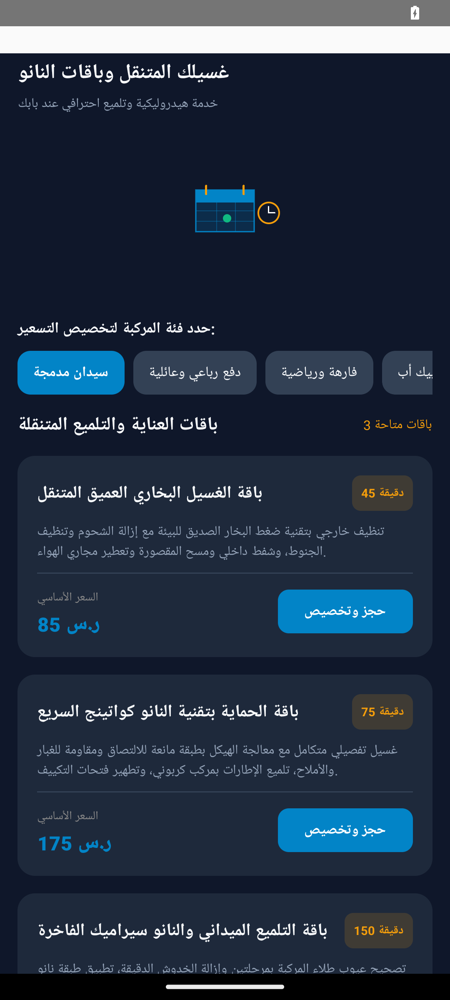
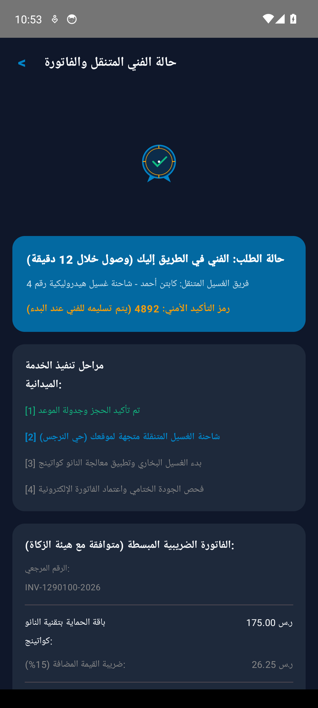

# غسيلك المتنقل وباقات النانو (Ghasaylik Mobile Car Wash & Nano Detailing #1290100)


-orange?style=flat)


> **منصة تشغيل ميدانية متكاملة لخدمات غسيل وتلميع المركبات وباقات النانو سيراميك المتنقلة**

---

## Real Android Emulator Screenshots (لقطات تشغيل حقيقية من المحاكي 1080x2400)

| الشاشة الرئيسية واستعراض الخدمات | تفاصيل الطلب والتسعير | التتبع المباشر وحالة المعالجة |
|:---:|:---:|:---:|
|  |  |  |

---

## Project Overview (نظرة عامة على المشروع)

مشروع تطبيقي متكامل لتشغيل خدمة غسيل وتلميع المركبات وباقات النانو سيراميك المتنقلة عند باب العميل. يتيح التطبيق للعميل تحديد فئة المركبة (سيدان، عائلية SUV، فارهة، بيك أب)، واختيار باقات العناية المتخصصة والخدمات الإضافية، وجدولة الموعد وتحديد الموقع بدقة، مع السداد الإلكتروني وتتبع مسار شاحنة الغسيل المتنقلة لحظة بلحظة حتى إتمام الخدمة وصدور الفاتورة الضريبية المعتمدة.

تم بناء النظام وفق مبادئ Clean Architecture و MVVM باستخدام Jetpack Compose مع الالتزام الصارم بـ Pure Vector Drawables وخلو تام من الرموز التعبيرية (Zero Emojis).

---

## Core Features (المميزات الرئيسية)

- **تخصيص تسعير المركبات**: دعم 4 فئات مركبات بمعاملات تسعير دقيقة.
- **باقات العناية المتخصصة**: غسيل بخاري عميق، نانو كواتينج سريع، وتلميع سيراميك VIP.
- **تتبع ميداني فوري**: تتبع مسار شاحنة الغسيل ورمز أمان التسليم وكابتن الخدمة.
- **فوترة ضريبية معتمدة**: متوافقة مع متطلبات هيئة الزكاة والضريبة والجمارك (ZATCA).

---

## Clean Architecture Layers

```
sa.factory.app1290100
├── data/
│   └── CarWashRepository.kt          # Flow-based reactive data source
├── model/
│   └── CarWashModels.kt              # Immutable business data structures
└── ui/
    ├── MainActivity.kt                # Jetpack Compose Entry Activity
    ├── CarWashViewModel.kt            # StateFlow UI state holder
    ├── CarWashHomeScreen.kt           # Discovery & packages catalog
    ├── CarWashDetailsScreen.kt        # Booking details & service scheduling
    ├── CarWashCheckoutScreen.kt       # Live van tracking & VAT invoice
    ├── BespokeVectorIllustration.kt   # Multi-path Compose Canvas drawings
    ├── DetailsActivity.kt             # Dedicated preview activity
    └── TrackingActivity.kt            # Dedicated preview activity
```

---

## Architectural Invariants & Security Threats

### Invariants (القواعد الصارمة):
- **`totalCalculationExact`**: Total price must equal base package price multiplied by vehicle category multiplier plus addons and 15% VAT with zero floating-point drift.
- **`statusTransitionsMonotonic`**: Booking status progression strictly advances: PENDING -> TECHNICIAN_ASSIGNED -> EN_ROUTE -> IN_PROGRESS -> COMPLETED.

### Threat Model (حماية البيانات والتهديدات):
- Customer PII and GPS coordinates are strictly encrypted and transmitted over TLS with certificate pinning.
- Ephemeral OTP confirmation codes guarantee verified service delivery handoff.

---

## Build Instructions

```bash
# Clone the repository
git clone https://github.com/hmoushim0-cloud/app-1290100.git
cd app-1290100

# Assemble Debug APK
./gradlew :app:assembleDebug
```

---

### Live Showcase & Cloud Verification

• Verified Showcase: https://hmoushim0-cloud.github.io/live-previews/?id=1290100
